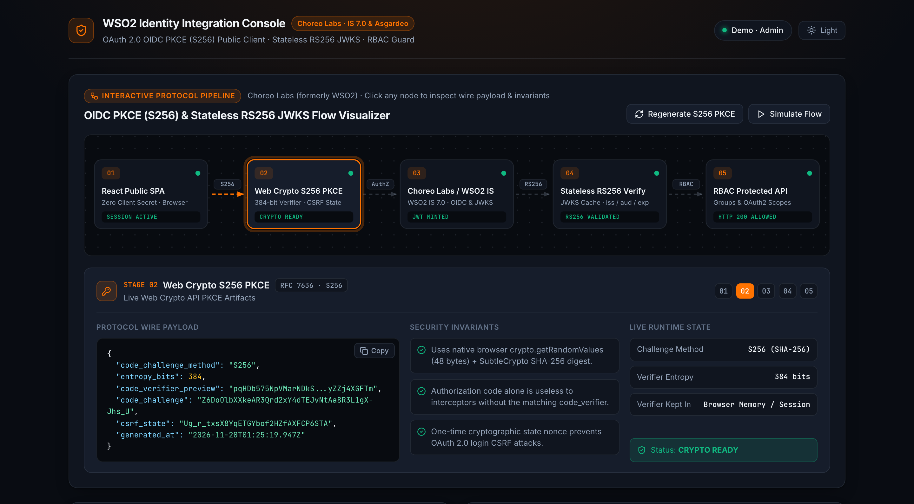
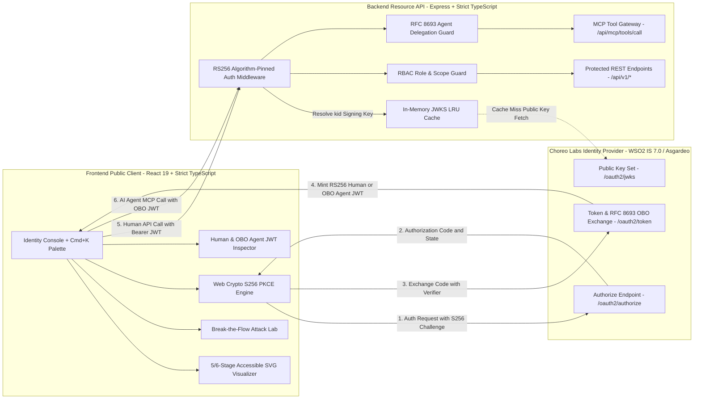
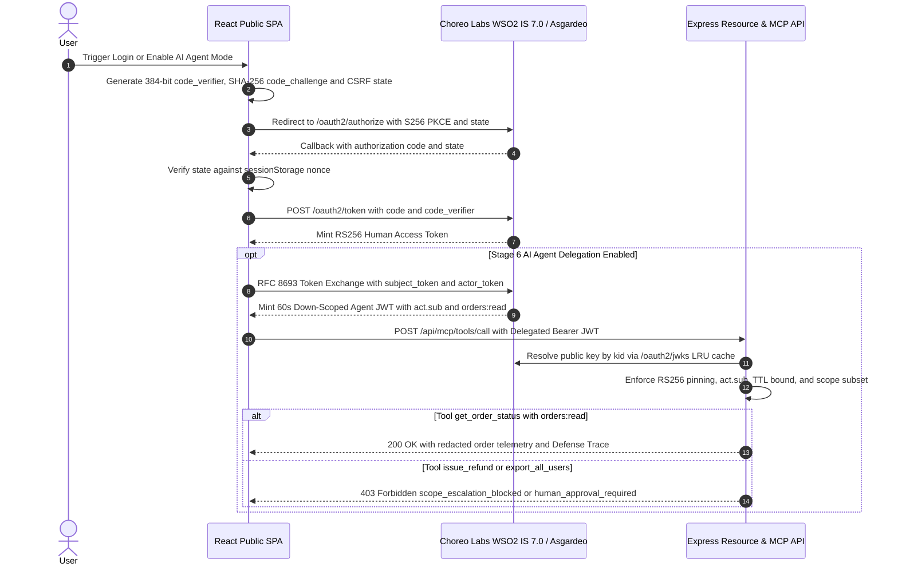

<div align="center">

# Choreo Labs (formerly WSO2) — Identity Integration Console, Attack Lab & AI Agent MCP Guard

**Principal-grade full-stack CIAM & AI Agent Identity reference platform for Choreo Labs (formerly WSO2) — WSO2 Identity Server 7.0 & Asgardeo.**
*Featuring an interactive 5-Stage Human CIAM + 6th-Stage RFC 8693 AI Agent Delegation & MCP Guard SVG pipeline, a 6-scenario Break-the-Flow Attack Lab, `Cmd+K` developer ergonomics, and zero-config Browser Simulation Mode.*

[](./LICENSE)
[](https://wso2.com/identity-server/)
[](./backend/src/routes/mcpRoutes.ts)
[](https://react.dev/)
[](https://www.typescriptlang.org/)
[](./backend/src/__tests__/security.test.ts)

</div>


---

## Executive Capabilities Summary

| Capability | Protocol / Standard | What You Can Inspect & Test |
| :--- | :--- | :--- |
| **5-Stage Human CIAM Pipeline** | `OAuth 2.0` · `OIDC Core 1.0` · `RFC 7636 S256` | Real browser Web Crypto 384-bit PKCE (`code_verifier`, SHA-256 `code_challenge`, CSRF `state`), WSO2 IS 7.0 / Asgardeo presets, stateless `RS256` JWKS LRU cache, and `requireRoles` / `requireScopes` guards. |
| **6th-Stage AI Agent Delegation & MCP Guard** | `RFC 8693 OBO` · `MCP tools/call` | Toggle **`Human CIAM (5-Stage)` ↔ `AI Agent + MCP (6-Stage)`** to mint a short-lived (**60s TTL**) down-scoped agent token with `act.sub: "agent:choreo-integrator-bot"` and test `POST /api/mcp/tools/call` (`get_order_status` → `200`, `issue_refund` → `403 Scope Escalation`, `export_all_users` → `403 Human Approval Required`). |
| **Break-the-Flow Security & Edge-Case Lab** | `RFC 7636` · `RFC 6749` · `RFC 8725` · `RFC 7517` · `RFC 7519` | Inject 6 real-world security faults (`PKCE Verifier Mismatch`, `CSRF State Replay`, `JWT alg:none / HS256 Downgrade`, `JWKS kid Key Rotation Miss [401 vs 200 Recover]`, `aud/iss Spoof`, `Expired Token / Clock Skew`) with live SVG error highlighting, wire payloads, and structured **Defense Traces**. |
| **Developer Ergonomics & Zero-Config Demo** | `Cmd+K` · `ARIA` · `Browser Simulation Mode` | Keyboard-navigable SVG nodes (`←`/`→`, `Home`/`End`, `prefers-reduced-motion`), `Cmd+K` / `Ctrl+K` Command Palette, Live Code Exporter (`curl` with redact/reveal toggle, strict TS `fetch`, WSO2/Asgardeo OIDC JSON), and automatic **Browser Simulation Mode** when Express/Docker is offline. |

---

## Quick Start: Local Full-Stack vs. Static Demo

```bash
# 1. Install dependencies (one-time)
npm install --prefix backend && npm install --prefix frontend

# 2. Run full verification (Strict TypeScript + ESLint + Prod Build + Vitest Security Suite)
npm run check

# 3. Preview instantly in Browser Simulation Mode (no Docker or backend required)
npm run dev:frontend

# 4. Or run Full-Stack with live Express RS256 JWKS + MCP Resource Server
npm run dev:backend   # Terminal 1 -> http://localhost:5050
npm run dev:frontend  # Terminal 2 -> http://localhost:5173
```

> **Static / Vercel / GitHub Pages Reviewers:** If the Express backend or WSO2 IS 7.0 Docker container is unreachable, the frontend automatically activates **Browser Simulation Mode** with zero console errors so every stage, Attack Lab fault, RBAC matrix check, and RFC 8693 MCP tool guard works out of the box.

---

## Visual Showcase

### 1. Interactive OIDC PKCE (S256) & Stateless RS256 JWKS Flow Visualizer

Click or Arrow-key through the protocol pipeline (`React Public SPA` -> `Web Crypto S256 PKCE` -> `Choreo Labs / WSO2 IS 7.0 & Asgardeo` -> `Stateless RS256 JWKS Verify` -> `RBAC Protected API` -> optional `AI Agent OBO -> MCP Guard`) to inspect live Web Crypto PKCE artifacts, Break-the-Flow Attack Lab defense traces, and RFC invariants.



### 2. Identity Control Plane, Live JWT Claims & RBAC Matrix Inspector, and API Test Bench

Switch seamlessly between **WSO2 Identity Server 7.0 (Local Docker)** and **Asgardeo Cloud (Choreo Labs SaaS)** presets, inspect Human or RFC 8693 Delegated Agent (`act.sub`, 60s TTL countdown, stripped scopes) JWT claims, preview real-time endpoint/MCP policies, and invoke protected endpoints with live latency telemetry.


### 3. First-Class Light & Dark Theme Parity (Asgardeo Cloud + 403 RBAC Policy Rejection)

Engineered with Apple / Linear developer-tool polish and full Dark/Light token parity across SVG pipeline graphs, syntax-highlighted JSON payloads, `Cmd+K` Command Palette, Code Exporter Drawer, and real-time RBAC / MCP policy rejection diagnostics (`HTTP 401` / `HTTP 403`).


---

## System Architecture (6-Stage CIAM + AI Agent MCP Delegation)



---

## OIDC PKCE, Attack Lab & RFC 8693 AI Agent Delegation Sequence



---

## Security Architecture & RFC Rigor

- **RFC 7636 PKCE Public Client Hardening**: Generates 384-bit (`48`-byte) cryptographic `code_verifier` values and `S256` (`SHA-256` Base64URL) `code_challenge` digests natively via the browser Web Crypto API, verified against RFC 7636 Appendix B test vectors in Vitest.
- **RFC 6749 §10.12 CSRF State Binding**: Enforces strict one-time cryptographic `state` validation on `/callback` before exchanging authorization codes at `/oauth2/token`.
- **RFC 8725 RS256 Algorithm Pinning & RFC 7517 JWKS Rotation**: Backend `createAuthMiddleware` explicitly pins `algorithms: ["RS256"]` to block `alg: "none"` and `HS256` key-confusion attacks, resolves keys by `kid` via `jwks-rsa` (10-min LRU cache, `maxEntries: 5`, rate-limited to `10 req/min`), and validates `iss`, `aud`, and `exp` (`±5s` clock tolerance) with structured `DefenseTrace` diagnostics.
- **RFC 8693 AI Agent Delegation & MCP Guard**: `requireAgentDelegation` + `evaluateMcpToolAuthorization` enforce an explicit `act.sub` actor claim (`agent:*`), cap delegated token TTL (`<= 300s`, 60s in console), block privilege escalation (`issue_refund` → `403 scope_escalation_blocked`), and mandate step-up human consent for bulk PII export (`export_all_users` → `403 human_approval_required`).
- **100% Strict TypeScript Discipline**: Both `frontend/` and `backend/` enforce `strict: true`, zero `any`, zero `@ts-ignore`, discriminated unions with exhaustive `assertNever` switches, and ESLint `@typescript-eslint/no-explicit-any: "error"`.

---

## API Specification

| Method | Endpoint | Access Policy | Description |
| :--- | :--- | :--- | :--- |
| `GET` | `/health` | Public | Resource server health status, uptime, issuer, JWKS URI, and MCP endpoint |
| `GET` | `/api/v1/public/info` | Public | Service metadata and Choreo Labs WSO2 IS 7.0 / Asgardeo protocol details |
| `GET` | `/api/v1/user/profile` | Authenticated `RS256` JWT | Extracts and returns verified identity claims (and optional `act` actor) |
| `GET` | `/api/v1/user/roles` | Authenticated `RS256` JWT | Lists resolved user groups, OAuth 2.0 scopes, and computed admin flag |
| `GET` | `/api/v1/admin/audit-logs` | RBAC Role (`admin`) | Returns security audit telemetry; rejects non-admin principals with `403` |
| `POST` | `/api/v1/reports` | OAuth2 Scope (`write:reports`) | Creates a compliance report when the `write:reports` scope is granted |
| `POST` | `/api/mcp/tools/call` | `RS256` + `RFC 8693 OBO` (`act.sub`) | Enforces `requireAgentDelegation`, short TTL, scope-subset checks, and human step-up consent |

---

## Automated Security Test Suite (Vitest)

Run deterministic cryptographic and policy tests across both workspaces:

```bash
# Run both backend and frontend Vitest suites
npm test

# Or run individual suites
npm run test:backend   # Ephemeral RSA-2048 keypair tests: RS256 pinning, exp/aud/iss/kid, RBAC, MCP OBO
npm run test:frontend  # RFC 7636 Appendix B S256 vector, JWT parser edge cases, RBAC dry-run & MCP simulation
```

---

## Repository Structure

```text
wso2-identity-integration-demo/
├── backend/
│   ├── src/
│   │   ├── __tests__/
│   │   │   └── security.test.ts         # Ephemeral RSA-2048 Vitest suite (RS256, RBAC, MCP OBO)
│   │   ├── config/
│   │   │   └── identityConfig.ts        # Strict typed environment loader (WSO2 IS & Asgardeo)
│   │   ├── middleware/
│   │   │   ├── authMiddleware.ts        # Stateless RS256 pinning, JWKS LRU cache & DefenseTrace
│   │   │   └── rbacMiddleware.ts        # requireRoles, requireScopes & requireAgentDelegation
│   │   ├── routes/
│   │   │   ├── apiRoutes.ts             # Public, authenticated, RBAC & scope-protected routes
│   │   │   └── mcpRoutes.ts             # POST /api/mcp/tools/call RFC 8693 MCP Tool Guard
│   │   ├── types/
│   │   │   └── auth.ts                  # Discriminated unions, ActorClaim & DefenseTrace types
│   │   └── server.ts                    # Hardened Express bootstrap (Helmet, CORS, graceful shutdown)
│   ├── .env.example
│   ├── eslint.config.mjs
│   ├── package.json
│   └── tsconfig.json
├── frontend/
│   ├── src/
│   │   ├── __tests__/
│   │   │   └── security.test.ts         # PKCE S256 vector, JWT decoding, RBAC & MCP Vitest suite
│   │   ├── components/
│   │   │   ├── ApiTestBench.tsx         # Live Express & Browser Simulation Test Bench + Defense Trace
│   │   │   ├── AttackLabPanel.tsx       # 6-scenario interactive Break-the-Flow Attack Lab
│   │   │   ├── AuthSessionCard.tsx      # WSO2 IS 7.0 / Asgardeo preset switcher & PKCE controls
│   │   │   ├── CodeExporterDrawer.tsx   # Live curl (redacted/revealed), strict TS & OIDC JSON exporter
│   │   │   ├── CommandPalette.tsx       # Zero-bloat Cmd+K / Ctrl+K keyboard command palette
│   │   │   ├── JsonHighlighter.tsx      # Memoized syntax-highlighted JSON & copy frame
│   │   │   ├── JwtClaimsInspector.tsx   # Human & RFC 8693 OBO Agent Claims, TTL & Policy Matrix
│   │   │   ├── OidcFlowVisualizer.tsx   # Accessible 5/6-stage SVG visualizer + MCP tool controls
│   │   │   └── TokenTtlBadge.tsx        # Isolated 1Hz TTL countdown component
│   │   ├── lib/
│   │   │   ├── apiClient.ts             # Typed API client, health probe & Browser Simulation engine
│   │   │   ├── pkce.ts                  # Web Crypto S256 PKCE, JWT parser & RFC 8693 OBO minter
│   │   │   └── securityLab.ts           # Discriminated Fault Lab states, MCP policies & code generator
│   │   ├── App.tsx                      # Root console, Cmd+K wiring, Flow Mode & theme state
│   │   ├── index.css                    # Apple/Linear Dark & Light design system + reduced-motion
│   │   ├── main.tsx
│   │   └── vite-env.d.ts
│   ├── .env.example
│   ├── eslint.config.mjs
│   ├── index.html
│   ├── package.json
│   ├── tsconfig.json
│   └── vite.config.ts
├── docker/
│   └── docker-compose.yml               # Local Choreo Labs / WSO2 Identity Server 7.0 stack
├── docs/
│   ├── choreo-labs-architecture-banner.svg  # 6-stage architecture banner
│   ├── screenshots/                     # High-res Light & Dark UI showcase captures
│   └── wso2-setup-guide.md              # Step-by-step WSO2 IS 7.0 & Asgardeo SP registration guide
├── .env.example
├── .gitignore
├── LICENSE
├── package.json
└── README.md
```

---

## Optional: Local WSO2 Identity Server 7.0 via Docker

```bash
cp backend/.env.example backend/.env
cp frontend/.env.example frontend/.env
npm run docker:up
```

Once healthy, access the WSO2 Identity Server 7.0 Console at `https://localhost:9443/console` and follow [docs/wso2-setup-guide.md](./docs/wso2-setup-guide.md) to register the SPA Public Client.

---

## License

This project is licensed under the **MIT License** — see the [LICENSE](./LICENSE) file for full details.

---

<div align="center">

**Engineered by Theekshana Sudeepa**

[](https://www.linkedin.com/in/theekshana-sudeepa/)
[](https://github.com/theekshana-sudeepa)
[](https://lexoratech.com)

</div>
