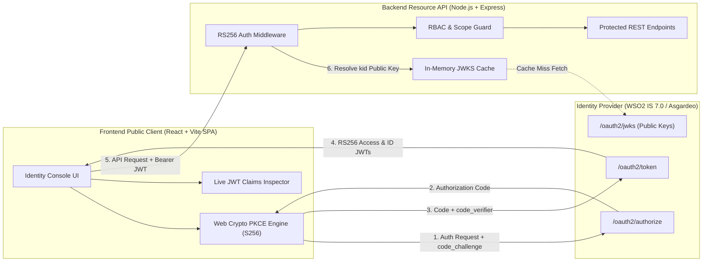
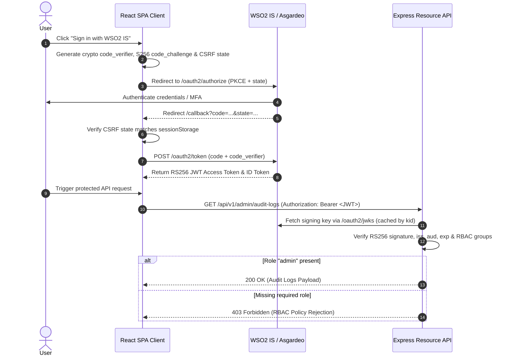

<div align="center">

# WSO2 Identity Server & Asgardeo Integration Demo

**Enterprise-grade full-stack reference implementation for Customer Identity & Access Management (CIAM) with WSO2 Identity Server 7.0 and Asgardeo.**
*Demonstrates OAuth 2.0 Authorization Code Flow with S256 PKCE, stateless RS256 JWKS token verification, and granular Role-Based Access Control (RBAC).*

[](./LICENSE)
[](https://wso2.com/identity-server/)
[](https://react.dev/)
[](https://www.typescriptlang.org/)
[](https://expressjs.com/)
[](https://www.docker.com/)

</div>

---

## System Architecture

The solution decouples identity governance from business logic by adopting a **Zero-Trust, Stateless OAuth 2.0 / OIDC architecture**. Public Single-Page Applications never store client secrets, while backend resource APIs cryptographically validate incoming RS256 Bearer JWTs against the Identity Provider's JWKS endpoint.



---

## OIDC PKCE & Stateless Verification Sequence



---

## Core Engineering Highlights

- **RFC 7636 PKCE Public Client Security**: Generates high-entropy cryptographic `code_verifier` values and SHA-256 `code_challenge` digests natively via the browser Web Crypto API, eliminating exposed client secrets in SPA bundles.
- **CSRF State Validation**: Enforces strict one-time `state` parameter matching on OAuth 2.0 callbacks to mitigate login CSRF attacks.
- **Stateless RS256 JWT Verification & JWKS Caching**: Uses `jwks-rsa` with in-memory key caching (10-minute TTL) and rate limiting to validate asymmetric JWT signatures, `iss`, `aud`, and `exp` claims with sub-millisecond overhead on cache hits.
- **Granular RBAC & Scope Middleware**: Decoupled `requireRoles(...)` and `requireScopes(...)` Express guards inspect `groups`, `roles`, and `scope` claims for fine-grained endpoint authorization.
- **Zero-Config Interactive Demo Mode**: Includes built-in simulated User and Admin JWT sessions in the frontend console so reviewers can inspect decoded claims and test UI workflows immediately—even without running a local IdP container.
- **Security Hardening**: Express backend enforces HTTP security headers via `helmet`, strict origin allow-listing via `cors`, payload size caps, and zero hardcoded credentials.

---

## API Specification

| Method | Endpoint | Access Policy | Description |
| :--- | :--- | :--- | :--- |
| `GET` | `/health` | Public | Resource server health status, uptime, and active JWKS URI |
| `GET` | `/api/v1/public/info` | Public | Service metadata and configured OIDC/JWKS protocol details |
| `GET` | `/api/v1/user/profile` | Authenticated JWT | Extracts and returns verified identity claims from RS256 Bearer token |
| `GET` | `/api/v1/user/roles` | Authenticated JWT | Lists assigned user groups, scopes, and computed administrator flag |
| `GET` | `/api/v1/admin/audit-logs` | RBAC (`admin`) | Returns security audit telemetry; rejects non-admin users with `403` |
| `POST` | `/api/v1/reports` | Scope (`write:reports`) | Creates a compliance report when the `write:reports` OAuth2 scope is granted |

---

## Repository Structure

```text
wso2-identity-integration-demo/
├── backend/
│   ├── src/
│   │   ├── config/
│   │   │   └── identityConfig.js     # Externalized environment variable loader
│   │   ├── middleware/
│   │   │   ├── authMiddleware.js     # RS256 JWT verification & JWKS cache
│   │   │   └── rbacMiddleware.js     # Role & OAuth2 scope enforcement guards
│   │   ├── routes/
│   │   │   └── apiRoutes.js          # Public, user, and RBAC-protected routes
│   │   └── server.js                 # Express bootstrap (Helmet, CORS, error handler)
│   ├── .env.example                  # Backend environment variable template
│   └── package.json
├── frontend/
│   ├── src/
│   │   ├── lib/
│   │   │   ├── apiClient.ts          # Bearer-authenticated API caller with latency metrics
│   │   │   └── pkce.ts               # Web Crypto PKCE (S256), OIDC exchange & JWT decoder
│   │   ├── App.tsx                   # Identity Console, JWT Inspector & API Test Bench
│   │   ├── index.css                 # Matte slate enterprise UI styles
│   │   ├── main.tsx
│   │   └── vite-env.d.ts
│   ├── .env.example                  # Frontend Vite environment template
│   ├── index.html
│   ├── package.json
│   ├── tsconfig.json
│   └── vite.config.ts
├── docker/
│   └── docker-compose.yml            # Local WSO2 Identity Server 7.0 orchestration
├── docs/
│   └── wso2-setup-guide.md           # Step-by-step WSO2 IS / Asgardeo SP registration guide
├── .env.example                      # Unified root environment reference
├── .gitignore                        # Hardened secret, key, and build artifact exclusions
├── LICENSE                           # MIT Open-Source License
├── package.json                      # Workspace orchestration scripts
└── README.md
```

---

## Getting Started

### Prerequisites

- **Node.js** `>= 20.x` and **npm** `>= 10.x`
- **Docker** & **Docker Compose** (optional, required only for local WSO2 Identity Server deployment; alternatively connect to [Asgardeo Cloud](https://wso2.com/asgardeo/))

### 1. Clone & Configure Environment

```bash
git clone https://github.com/theekshana-sudeepa/wso2-identity-integration-demo.git
cd wso2-identity-integration-demo

cp backend/.env.example backend/.env
cp frontend/.env.example frontend/.env
```

Update `frontend/.env` with your `VITE_CLIENT_ID` and `backend/.env` with your WSO2 IS / Asgardeo issuer details. See [docs/wso2-setup-guide.md](./docs/wso2-setup-guide.md) for exact application registration steps.

### 2. Launch Local WSO2 Identity Server (Optional)

```bash
npm run docker:up
```

Once healthy, access the WSO2 Identity Server Console at `https://localhost:9443/console`.

### 3. Install Dependencies & Run Services

```bash
# Install dependencies
npm install --prefix backend
npm install --prefix frontend

# Start Express Resource Server (http://localhost:5050)
npm run dev:backend

# In a separate terminal, start React SPA Client (http://localhost:5173)
npm run dev:frontend
```

### 4. Verify Production Build

```bash
npm run check --prefix backend
npm run build --prefix frontend
```

---

## License

This project is licensed under the **MIT License** — see the [LICENSE](./LICENSE) file for full details.

---

<div align="center">

**Engineered by Theekshana Sudeepa**

[](https://www.linkedin.com/in/theekshana-sudeepa/)
[](https://github.com/theekshana-sudeepa)
[](https://lexoratech.com)

</div>
