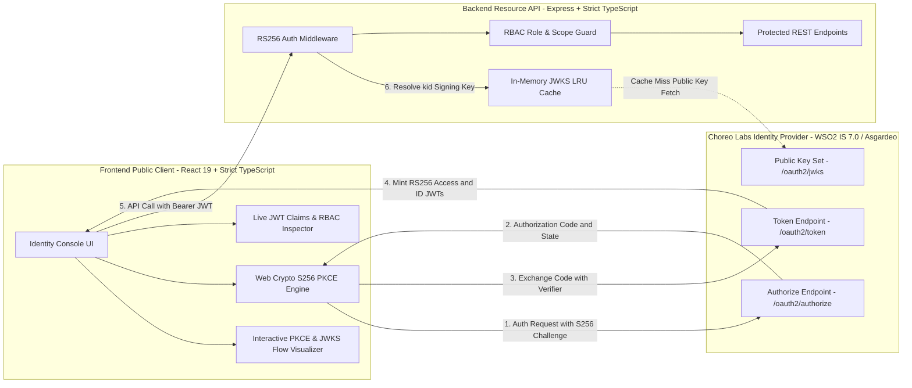
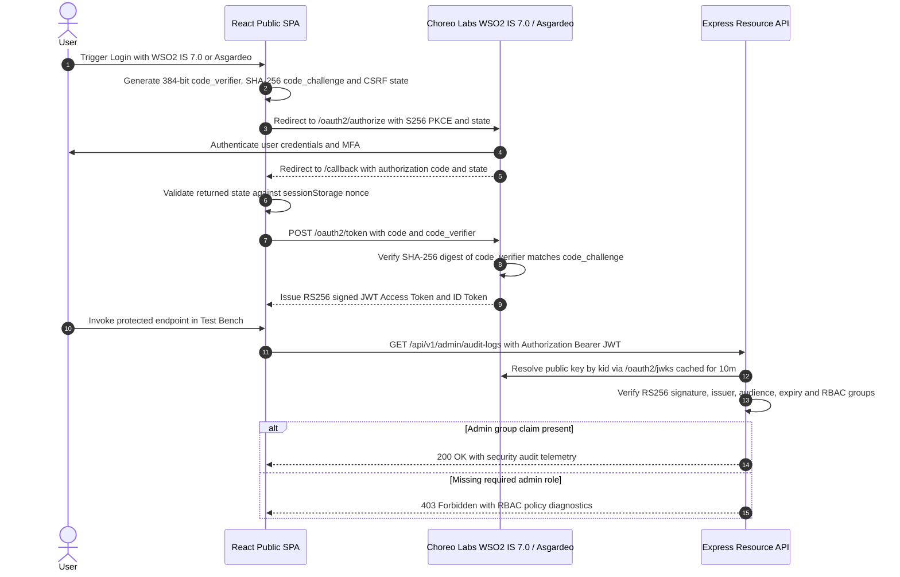

<div align="center">

# Choreo Labs (formerly WSO2) — Identity Integration Console & PKCE Flow Visualizer

**Flagship full-stack CIAM reference platform for Choreo Labs (formerly WSO2) — WSO2 Identity Server 7.0 & Asgardeo.**
*Featuring an interactive OIDC S256 PKCE & RS256 JWKS visual protocol pipeline, live JWT Claims & RBAC Matrix Inspector, and a strict TypeScript Express resource server.*

[](./LICENSE)
[](https://wso2.com/identity-server/)
[](https://react.dev/)
[](https://www.typescriptlang.org/)
[](https://expressjs.com/)
[](./docker/docker-compose.yml)

</div>

---

## Visual Showcase

### 1. Interactive OIDC PKCE (S256) & Stateless RS256 JWKS Flow Visualizer

Click any node along the 5-stage protocol pipeline (`React Public SPA` -> `Web Crypto S256 PKCE` -> `Choreo Labs / WSO2 IS 7.0 & Asgardeo` -> `Stateless RS256 JWKS Verify` -> `RBAC Protected API`) to inspect real Web Crypto API PKCE artifacts, wire payloads, RFC security invariants, and live runtime state without needing an external IdP to explore the flow.


### 2. Identity Control Plane, Live JWT Claims & RBAC Matrix Inspector, and API Test Bench

Switch seamlessly between **WSO2 Identity Server 7.0 (Local Docker)** and **Asgardeo Cloud (Choreo Labs SaaS)** presets, inspect decoded RS256 headers, groups, and OAuth 2.0 scopes, preview real-time endpoint authorization decisions, and invoke protected Express endpoints with live latency telemetry.


### 3. First-Class Light & Dark Theme Parity (Asgardeo Cloud + 403 RBAC Policy Rejection)

Engineered with Apple / Linear developer-tool polish and full Dark/Light token parity across SVG pipeline graphs, syntax-highlighted JSON payloads, and real-time RBAC rejection diagnostics (`HTTP 403 Forbidden`).


---

## System Architecture

The platform decouples identity governance from application business logic using a **Zero-Trust, Stateless OAuth 2.0 / OIDC architecture** compatible with both **WSO2 Identity Server 7.0** and **Asgardeo Cloud** from **Choreo Labs (formerly WSO2)**. Public Single-Page Applications never hold client secrets, while backend resource APIs cryptographically validate incoming asymmetric `RS256` Bearer JWTs against the tenant JWKS endpoint.



---

## OIDC PKCE & Stateless RS256 Verification Sequence



---

## Security Architecture

- **RFC 7636 PKCE Public Client Hardening**: Generates 384-bit (`48`-byte) cryptographic `code_verifier` values and `S256` (`SHA-256` Base64URL) `code_challenge` digests natively via the browser Web Crypto API (`crypto.getRandomValues` + `crypto.subtle.digest`), ensuring zero client secrets ever ship in frontend bundles.
- **CSRF State Binding**: Enforces strict one-time cryptographic `state` validation on `/callback` before exchanging authorization codes at `/oauth2/token`.
- **Stateless RS256 Algorithm Pinning & JWKS Caching**: Backend `authMiddleware` explicitly pins `algorithms: ["RS256"]` to block `alg: none` and HMAC key-confusion attacks, resolves signing keys by JWT `kid` via `jwks-rsa` with a 10-minute in-memory cache (`maxEntries: 5`, rate-limited to `10 req/min`), and validates `iss`, `aud`, and `exp` with zero database lookups.
- **Decoupled RBAC & OAuth 2.0 Scope Guards**: Express middleware separates coarse-grained identity groups (`requireRoles("admin", "administrator")`) from granular API capabilities (`requireScopes("write:reports")`), normalizing both array and comma-delimited WSO2 IS / Asgardeo claim formats.
- **Defense-in-Depth Express Surface**: Enforces HTTP security headers via `helmet`, strict origin allow-listing via `cors`, `1mb` JSON payload caps, strict input sanitization, and graceful `SIGTERM`/`SIGINT` server shutdown.

---

## Frontend Developer-Tool Architecture

- **Interactive 5-Stage SVG/React Protocol Pipeline (`OidcFlowVisualizer.tsx`)**: Visualizes the complete `SPA -> PKCE -> Choreo Labs IdP -> RS256 JWKS -> RBAC API` handshake with animated active connectors, live Web Crypto PKCE regeneration, step-through simulation playback, and a synchronized 3-pane stage inspector (Protocol Wire Payload, Security Invariants, Live Runtime Telemetry).
- **Multi-Tab Live JWT Claims & RBAC Matrix Inspector (`JwtClaimsInspector.tsx`)**: Parses active Bearer JWTs into a visual identity summary, cryptographic metadata strip (`alg`, `kid`, `aud`), role/scope pills, a real-time 5-endpoint authorization preview matrix, syntax-highlighted decoded JSON, and color-coded raw compact JWT segments.
- **Dual-Mode Protected API Test Bench (`ApiTestBench.tsx`)**: Probes live Express `/health` telemetry and supports both **Live Express API** invocations (proving real `401` cryptographic signature rejection on unsigned demo tokens) and **Policy Dry-Run** mode (allowing instant exploration of `200 OK`, `201 Created`, and `403 Forbidden` RBAC decisions without spinning up Docker).
- **100% Strict TypeScript & Zero-`any` Discipline**: Both `frontend/` and `backend/` enforce `strict: true`, `noImplicitAny: true`, and ESLint `@typescript-eslint/no-explicit-any: "error"`.

---

## API Specification

| Method | Endpoint | Access Policy | Description |
| :--- | :--- | :--- | :--- |
| `GET` | `/health` | Public | Resource server health status, uptime, issuer, and active JWKS URI |
| `GET` | `/api/v1/public/info` | Public | Service metadata and Choreo Labs WSO2 IS 7.0 / Asgardeo protocol details |
| `GET` | `/api/v1/user/profile` | Authenticated `RS256` JWT | Extracts and returns verified identity claims from the Bearer token |
| `GET` | `/api/v1/user/roles` | Authenticated `RS256` JWT | Lists resolved user groups, OAuth 2.0 scopes, and computed admin flag |
| `GET` | `/api/v1/admin/audit-logs` | RBAC Role (`admin`) | Returns security audit telemetry; rejects non-admin principals with `403` |
| `POST` | `/api/v1/reports` | OAuth2 Scope (`write:reports`) | Creates a compliance report when the `write:reports` scope is granted |

---

## Repository Structure

```text
wso2-identity-integration-demo/
├── backend/
│   ├── src/
│   │   ├── config/
│   │   │   └── identityConfig.ts        # Strict typed environment loader (WSO2 IS & Asgardeo)
│   │   ├── middleware/
│   │   │   ├── authMiddleware.ts        # Stateless RS256 JWT verification & JWKS cache
│   │   │   └── rbacMiddleware.ts        # Role & OAuth 2.0 scope authorization guards
│   │   ├── routes/
│   │   │   └── apiRoutes.ts             # Public, authenticated, RBAC & scope-protected routes
│   │   ├── types/
│   │   │   └── auth.ts                  # Express Request augmentation & verified JWT claim types
│   │   └── server.ts                    # Hardened Express bootstrap (Helmet, CORS, graceful shutdown)
│   ├── .env.example                     # Backend environment template (WSO2 IS 7.0 & Asgardeo)
│   ├── eslint.config.mjs                # Strict ESLint v9 flat config (zero explicit any)
│   ├── package.json
│   └── tsconfig.json
├── frontend/
│   ├── src/
│   │   ├── components/
│   │   │   ├── ApiTestBench.tsx         # Protected API test bench with Live & Policy Dry-Run modes
│   │   │   ├── AuthSessionCard.tsx      # WSO2 IS 7.0 / Asgardeo preset switcher & PKCE controls
│   │   │   ├── JsonHighlighter.tsx      # Zero-dependency syntax-highlighted JSON & copy frame
│   │   │   ├── JwtClaimsInspector.tsx   # Multi-tab Claims/RBAC Matrix, JSON & Raw JWT inspector
│   │   │   └── OidcFlowVisualizer.tsx   # Interactive 5-stage SVG PKCE & RS256 JWKS visualizer
│   │   ├── lib/
│   │   │   ├── apiClient.ts             # Typed API client, health probe & RBAC policy evaluator
│   │   │   └── pkce.ts                  # Web Crypto S256 PKCE engine, OIDC exchange & JWT parser
│   │   ├── App.tsx                      # Root console layout & Light/Dark theme state
│   │   ├── index.css                    # Apple/Linear Dark & Light design system tokens
│   │   ├── main.tsx
│   │   └── vite-env.d.ts
│   ├── .env.example                     # Frontend Vite template (WSO2 IS 7.0 & Asgardeo)
│   ├── eslint.config.mjs                # Strict ESLint v9 + React Hooks config
│   ├── index.html
│   ├── package.json
│   ├── tsconfig.json
│   └── vite.config.ts
├── docker/
│   └── docker-compose.yml               # Local Choreo Labs / WSO2 Identity Server 7.0 stack
├── docs/
│   ├── screenshots/                     # High-res Light & Dark UI showcase captures
│   └── wso2-setup-guide.md              # Step-by-step WSO2 IS 7.0 & Asgardeo SP registration guide
├── .env.example                         # Unified root environment reference
├── .gitignore                           # Hardened secret, certificate & build exclusions
├── LICENSE                              # MIT Open-Source License
├── package.json                         # Monorepo workspace orchestration scripts
└── README.md
```

---

## Getting Started

### Prerequisites

- **Node.js** `>= 20.x` and **npm** `>= 10.x`
- **Docker** & **Docker Compose** (optional — required only for local WSO2 Identity Server 7.0 deployment; alternatively connect directly to **Asgardeo Cloud** or explore immediately via built-in Demo Tokens & Policy Dry-Run)

### 1. Clone & Configure Environment

```bash
git clone https://github.com/theekshana-sudeepa/wso2-identity-integration-demo.git
cd wso2-identity-integration-demo

cp backend/.env.example backend/.env
cp frontend/.env.example frontend/.env
```

Update `frontend/.env` with your `VITE_CLIENT_ID` and `backend/.env` with your **WSO2 Identity Server 7.0** or **Asgardeo Cloud** tenant URLs. See [docs/wso2-setup-guide.md](./docs/wso2-setup-guide.md) for exact application registration steps.

### 2. Launch Local WSO2 Identity Server 7.0 (Optional)

```bash
npm run docker:up
```

Once the health check passes, access the WSO2 Identity Server 7.0 Console at `https://localhost:9443/console`.

### 3. Install Dependencies & Run Services

```bash
# Install workspace dependencies
npm install --prefix backend
npm install --prefix frontend

# Start Express Resource Server (http://localhost:5050)
npm run dev:backend

# In a separate terminal, start React SPA Console (http://localhost:5173)
npm run dev:frontend
```

### 4. Run Full TypeScript, Lint & Production Build Verification

```bash
# Runs tsc --noEmit, ESLint, and production builds across both backend & frontend
npm run check
```

---

## License

This project is licensed under the **MIT License** — see the [LICENSE](./LICENSE) file for full details.

---

<div align="center">

**Engineered by Theekshana Sudeepa**

[](https://www.linkedin.com/in/theekshana-sudeepa/)
[](https://github.com/theekshana-sudeepa)
[](https://lexoratech.com)

</div>
