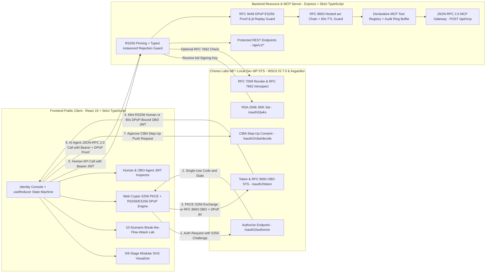
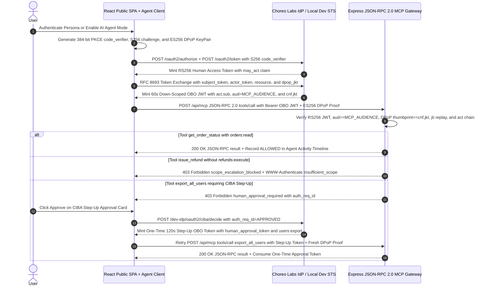

<div align="center">

# Choreo Labs (formerly WSO2) — Identity Integration Console, Attack Lab & AI Agent MCP Guard (v2.0)

**Cryptographically real, spec-compliant full-stack CIAM & AI Agent Identity reference platform for Choreo Labs (formerly WSO2) — WSO2 Identity Server 7.0, Asgardeo & Local Dev IdP / STS.**
*Featuring a 5-Stage Human CIAM + 6th-Stage RFC 8693 / RFC 9449 DPoP / CIBA AI Agent MCP Guard SVG pipeline, a 10-scenario Break-the-Flow Attack Lab, JSON-RPC 2.0 MCP Gateway, and real Web Crypto RS256/ES256 Browser Simulation Mode.*

### [▶ Launch Interactive Live Demo (GitHub Pages)](https://theekshana-sudeepa.github.io/wso2-identity-integration-demo/)

[](https://theekshana-sudeepa.github.io/wso2-identity-integration-demo/)
[](https://github.com/theekshana-sudeepa/wso2-identity-integration-demo/actions)
[](./LICENSE)
[](https://wso2.com/identity-server/)
[](./backend/src/routes/mcpRoutes.ts)
[](https://www.typescriptlang.org/)
[](./backend/src/__tests__/security.test.ts)

</div>


---

## Executive Capabilities Summary

| Capability | Protocol / Standard | What You Can Inspect & Test |
| :--- | :--- | :--- |
| **5-Stage Human CIAM + Local Dev IdP / STS** | `OAuth 2.0` · `OIDC Core 1.0` · `RFC 7636 S256` · `RFC 7517` | In-process RSA-2048 Dev IdP (`/dev-idp/*`) with active + rotated `kid` keys, real SHA-256 PKCE code exchange (`developer`, `admin`, `auditor` personas), stateless `RS256` JWKS LRU cache, and **Stage 04 Stateless JWKS vs. RFC 7662 Token Introspection + RFC 7009 Revocation** trade-off toggle. |
| **Spec-Compliant MCP Gateway & RFC 8693 OBO** | `MCP 2025-06-18` · `JSON-RPC 2.0` · `RFC 8693` · `RFC 9728` · `RFC 8707` | `POST /api/mcp` (`tools/list` & `tools/call`), `GET /.well-known/oauth-protected-resource`, RFC 8707 resource-bound `MCP_AUDIENCE` (blocking token passthrough), declarative tool registry with JSON Schema validation, `60s` max TTL (`AGENT_TOKEN_MAX_TTL_SECONDS`), nested `act` chain (`depth <= 2`, acyclic) + `may_act` (§4.4), and live **Agent Activity Timeline** (`GET /api/mcp/audit`). |
| **CIBA Human-in-the-Loop & RFC 9449 DPoP** | `RFC 9449 DPoP (ES256)` · `CIBA Step-Up Consent` | Sender-constrained agent OBO tokens (`cnf.jkt` bound to Web Crypto `ES256` keypair + `dpop+jwt` proof verification + `jti` replay cache) and interactive **CIBA Push Approval Card** (`auth_req_id` → one-time `120s` step-up consent unlocking `export_all_users`). |
| **10-Scenario Break-the-Flow Attack Lab** | `RFC 7636` · `RFC 6749` · `RFC 8725` · `RFC 7519` · `RFC 8693` · `RFC 9449` · `RFC 8707` | Inject 10 real cryptographic faults (`PKCE Verifier Mismatch [Side-by-Side SHA-256]`, `CSRF State Replay`, `JWT alg:none / HS256 Public-PEM Confusion`, `JWKS kid Miss [401 vs 200 Rotated Key Recover]`, `aud/iss Spoof`, `Expired Token`, `Stolen Agent Token Replay [No DPoP Key]`, `Token Passthrough [RFC 8707]`, `act Chain Depth / Cycle`, `Unauthorized Actor [may_act]`). |
| **Real Web Crypto Browser Simulation Mode** | `Web Crypto RSASSA-PKCS1-v1_5 & ECDSA P-256` · `Cmd+K` | Static hosting (GitHub Pages) generates real RSA-2048 & ECDSA P-256 keypairs in the browser (`browserCrypto.ts`), signs & cryptographically verifies demo/fault JWTs via `crypto.subtle.verify`, and stays synced with the backend via `@choreo-demo/identity-policy` contract tests. |

---

## Quick Start: Local Full-Stack, Docker Profiles & Static Demo

```bash
# 1. Install dependencies
npm install --prefix backend && npm install --prefix frontend

# 2. Run full verification (Strict TypeScript + ESLint + Prod Build + 37 Vitest Security & Contract Specs)
npm run check

# 3. Run Full-Stack with live Express RS256 JWKS Resource Server + Local Dev IdP / STS
npm run dev:backend   # Terminal 1 -> http://localhost:5050 (API + Dev IdP + Scalar Docs at /api/docs)
npm run dev:frontend  # Terminal 2 -> http://localhost:5173

# 4. Or launch via Docker Compose (Fast Dev IdP profile or Full WSO2 IS 7.0 + DCR Bootstrap profile)
docker compose -f docker/docker-compose.yml --profile dev up --build
# docker compose -f docker/docker-compose.yml --profile wso2 up -d
```

---

## Visual Showcase

### 1. Interactive OIDC PKCE (S256) & Stateless RS256 JWKS Flow Visualizer

Click or Arrow-key through the protocol pipeline (`React Public SPA` -> `Web Crypto S256 PKCE` -> `Choreo Labs / WSO2 IS 7.0 & Dev IdP` -> `Stateless RS256 JWKS Verify` -> `RBAC Protected API` -> `AI Agent OBO + DPoP -> MCP Gateway`) to inspect live Web Crypto PKCE artifacts, Break-the-Flow Attack Lab defense traces, and RFC invariants.


### 2. Identity Control Plane, Live JWT Claims & RBAC Matrix Inspector, and API Test Bench

Switch seamlessly between **WSO2 Identity Server 7.0** and **Asgardeo Cloud** presets, authenticate with **Developer**, **Admin**, or **Auditor** personas via real S256 PKCE exchanges, inspect Human or RFC 8693 + DPoP Delegated Agent (`act.sub`, `cnf.jkt`, 60s TTL countdown, stripped scopes) JWT claims, and invoke protected endpoints with live latency telemetry.


### 3. First-Class Light & Dark Theme Parity (Asgardeo Cloud + 403 RBAC Policy Rejection)

Engineered with Apple / Linear developer-tool polish and full Dark/Light token parity across SVG pipeline graphs, syntax-highlighted JSON payloads, `Cmd+K` Command Palette, Code Exporter Drawer, and real-time RBAC / MCP policy rejection diagnostics (`HTTP 401` / `HTTP 403` with RFC 6750 `WWW-Authenticate` challenges).


---

## System Architecture (6-Stage CIAM + AI Agent MCP Delegation + DPoP + CIBA)



---

## OIDC PKCE, RFC 8693 OBO, RFC 9449 DPoP & CIBA Step-Up Sequence



---

## API & Protocol Endpoints Specification

| Method | Endpoint | Access Policy | Description |
| :--- | :--- | :--- | :--- |
| `GET` | `/health` | Public | Resource server & Dev IdP status, active/rotated `kid`, `audience`, and `mcpAudience` |
| `GET` | `/.well-known/oauth-protected-resource` | Public (`RFC 9728`) | Protected Resource Metadata (`resource`, `authorization_servers`, `scopes_supported`, `dpop_signing_alg_values_supported`) |
| `GET` | `/api/openapi.json` & `/api/docs` | Public (`OpenAPI 3.1`) | Machine-readable OpenAPI 3.1 specification and interactive Scalar API Reference UI |
| `GET` | `/api/v1/public/info` | Public | Service metadata and Choreo Labs WSO2 IS 7.0 / Asgardeo protocol details |
| `GET` | `/api/v1/user/profile` | `RS256` JWT (`jwks` or `introspect`) | Verified identity claims; supports `X-Verification-Mode: jwks \| introspect` |
| `GET` | `/api/v1/user/roles` | `RS256` JWT | Resolved RBAC groups, OAuth 2.0 scopes, and computed admin flag |
| `GET` | `/api/v1/admin/audit-logs` | RBAC Role (`admin`) | Security audit telemetry; rejects non-admin principals with `403` + `WWW-Authenticate` |
| `POST` | `/api/v1/reports` | OAuth2 Scope (`write:reports`) | Creates a compliance report when `write:reports` scope is granted |
| `POST` | `/api/mcp` (and `/api/mcp/tools/call`) | `RS256` (`MCP_AUDIENCE`) + `RFC 8693 act` + `RFC 9449 DPoP` | JSON-RPC 2.0 MCP Gateway (`tools/list` & `tools/call`) with `60s` TTL, nested `act` guard, schema validation, and CIBA step-up |
| `GET` | `/api/mcp/audit` | Public Demo Telemetry | Returns the in-memory ring buffer (`50` entries) of delegated AI agent tool decisions |
| `GET` | `/dev-idp/.well-known/openid-configuration` | Dev IdP (`DEV_IDP_ENABLED`) | Local Dev IdP OIDC Discovery metadata and seeded personas (`developer`, `admin`, `auditor`) |
| `GET` | `/dev-idp/oauth2/jwks` | Dev IdP (`RFC 7517`) | Publishes active and rotated RSA-2048 public keys in JWK Set format |
| `POST` | `/dev-idp/oauth2/authorize` & `/dev-idp/oauth2/token` | Dev IdP / STS | Issues single-use S256 PKCE authorization codes, verifies `code_verifier` SHA-256 digests, and performs RFC 8693 OBO token exchanges |
| `POST` | `/dev-idp/oauth2/ciba/decide` | Dev IdP CIBA Step-Up | Approves or denies pending `auth_req_id` step-up consent requests and mints one-time approval claims |
| `POST` | `/dev-idp/oauth2/revoke` & `/dev-idp/oauth2/introspect` | Dev IdP (`RFC 7009` / `7662`) | Revokes active tokens and provides stateful RFC 7662 introspection responses |

---

## Architecture Decision Records (ADRs) & Threat Model

- **[STRIDE Threat Model & Control Matrix](./docs/threat-model.md)** — Maps every Attack Lab fault and threat vector to normative RFC sections, middleware guards, and Vitest test names.
- **[ADR 0001: Stateless RS256 JWKS Verification vs. Stateful RFC 7662 Token Introspection](./docs/adr/0001-stateless-jwks-vs-token-introspection.md)**
- **[ADR 0002: RFC 8693 On-Behalf-Of (OBO) Token Exchange Over Token Passthrough for MCP Agents](./docs/adr/0002-rfc8693-obo-over-token-passthrough.md)**
- **[ADR 0003: RFC 9449 DPoP Sender-Constrained Tokens for Delegated AI Agents](./docs/adr/0003-rfc9449-dpop-for-ai-agents.md)**
- **[ADR 0004: Shared Pure-TypeScript Identity Policy Package & Contract Testing](./docs/adr/0004-shared-identity-policy-package.md)**

---

## Repository Structure

```text
wso2-identity-integration-demo/
├── packages/
│   └── identity-policy/                 # Shared pure-TS policy constants, RBAC matrix & types
│       ├── src/index.ts
│       ├── package.json
│       └── tsconfig.json
├── backend/
│   ├── src/
│   │   ├── __tests__/
│   │   │   ├── advancedAgentSecurity.test.ts # CIBA step-up, RFC 9449 DPoP & RFC 7662 introspection specs
│   │   │   ├── agentPolicy.drift.test.ts     # Frontend/backend constant drift guard
│   │   │   ├── delegationPolicy.test.ts      # RFC 8693 §4.1 nested act & §4.4 may_act unit tests
│   │   │   ├── devIdp.test.ts                # Local Dev IdP PKCE S256, OBO STS & live Attack Lab specs
│   │   │   ├── mcpSpec.test.ts               # JSON-RPC 2.0, RFC 9728, RFC 8707 & audit ring buffer specs
│   │   │   ├── policyContract.test.ts        # Full-matrix contract test (Shared Policy vs Express)
│   │   │   └── security.test.ts              # RS256 pinning, typed errors, RFC 6750 headers & audience isolation
│   │   ├── config/
│   │   │   ├── agentPolicy.ts                # Canonical 60s TTL & max delegation depth constants
│   │   │   └── identityConfig.ts             # Strict environment loader (Dev IdP, WSO2 IS & Asgardeo)
│   │   ├── devIdp/
│   │   │   ├── devIdpRouter.ts               # OIDC Discovery, JWKS, PKCE S256, RFC 8693 STS, CIBA & Revocation
│   │   │   ├── keyStore.ts                   # RSA-2048 active/rotated key manager with jose
│   │   │   └── personas.ts                   # Seeded developer, admin & auditor personas with may_act
│   │   ├── mcp/
│   │   │   ├── auditLog.ts                   # In-memory ring buffer for Agent Activity Timeline
│   │   │   ├── cibaStore.ts                  # One-time CIBA step-up approval state manager
│   │   │   └── toolRegistry.ts               # Declarative MCP tool schemas, risk tiers & policy evaluator
│   │   ├── middleware/
│   │   │   ├── authMiddleware.ts             # Stateless RS256 pinning, JWKS LRU cache & introspection toggle
│   │   │   ├── bearerChallenge.ts            # RFC 6750 + RFC 9728 WWW-Authenticate header builder
│   │   │   ├── delegationPolicy.ts           # Iterative act chain & may_act policy evaluators
│   │   │   ├── dpopMiddleware.ts             # RFC 9449 ES256 DPoP proof & jti replay verifier
│   │   │   ├── jwtRejection.ts               # Typed instanceof JWT error classification & DefenseTrace
│   │   │   ├── rateLimitAndLogger.ts         # Sliding-window rate limiter & X-Request-Id structured logger
│   │   │   └── rbacMiddleware.ts             # requireRoles, requireScopes & requireAgentDelegation
│   │   ├── routes/
│   │   │   ├── apiRoutes.ts                  # Public, authenticated, RBAC & scope-protected REST routes
│   │   │   ├── mcpRoutes.ts                  # JSON-RPC 2.0 MCP Gateway & audit log route
│   │   │   └── openApiSpec.ts                # OpenAPI 3.1 spec generator & Scalar API Reference UI
│   │   ├── types/
│   │   │   └── auth.ts                       # Discriminated unions, ActorClaim & DefenseTrace types
│   │   └── server.ts                         # Hardened Express bootstrap
│   └── Dockerfile
├── frontend/
│   ├── src/
│   │   ├── __tests__/
│   │   │   ├── flowAndState.test.ts          # ConsoleReducer, StageDescriptors, DPoP, CIBA & Exporter tests
│   │   │   └── security.test.ts              # RFC 7636 S256 vector & Web Crypto RS256 verification suite
│   │   ├── components/
│   │   │   ├── flow/
│   │   │   │   ├── FlowCanvas.tsx            # Accessible 5/6-stage SVG pipeline graph
│   │   │   │   ├── McpToolStrip.tsx          # Stage 06 MCP tools, CIBA approval card & audit timeline
│   │   │   │   ├── StageInspector.tsx        # Synchronized stage inspector & Stage 04 JWKS/Introspection toggle
│   │   │   │   ├── StageNode.tsx             # Memoized keyboard-navigable SVG node
│   │   │   │   └── stageDescriptors.ts       # Pure stage descriptor builder functions
│   │   │   ├── ApiTestBench.tsx
│   │   │   ├── AttackLabPanel.tsx            # 10-scenario interactive Break-the-Flow Attack Lab
│   │   │   ├── AuthSessionCard.tsx           # WSO2 IS / Asgardeo preset switcher & 3 seeded personas
│   │   │   ├── CodeExporterDrawer.tsx
│   │   │   ├── CommandPalette.tsx
│   │   │   ├── JsonHighlighter.tsx
│   │   │   ├── JwtClaimsInspector.tsx
│   │   │   ├── OidcFlowVisualizer.tsx        # Modular flow orchestrator
│   │   │   └── TokenTtlBadge.tsx
│   │   ├── lib/
│   │   │   ├── agentPolicy.ts                # Mirrored 60s TTL & max depth constants (drift-guarded)
│   │   │   ├── apiClient.ts                  # Live Dev IdP / JSON-RPC client & Web Crypto verified simulator
│   │   │   ├── browserCrypto.ts              # Web Crypto RSASSA-PKCS1-v1_5 & ECDSA P-256 signing/verification
│   │   │   ├── pkce.ts                       # Web Crypto S256 PKCE, JWT parser & Simulated STS minter
│   │   │   └── securityLab.ts                # 10 Attack Lab fault evaluators & JSON-RPC code generator
│   │   ├── state/
│   │   │   └── consoleReducer.ts             # Pure useReducer state machine & ConsoleContext
│   │   └── App.tsx
│   └── Dockerfile
├── e2e/
│   └── console.spec.ts                       # Playwright E2E verification suite
├── docker/
│   ├── docker-compose.yml                    # --profile dev (fast full stack) & --profile wso2 (IS 7.0 + DCR)
│   └── wso2-bootstrap.sh                     # Automated WSO2 IS 7.0 DCR & SCIM2 bootstrap script
├── docs/
│   ├── adr/                                  # 4 Architecture Decision Records
│   ├── screenshots/                          # UI showcase captures
│   ├── threat-model.md                       # STRIDE threat-to-control matrix
│   └── wso2-setup-guide.md
├── .github/
│   ├── dependabot.yml
│   └── workflows/                            # ci.yml, deploy.yml (GitHub Pages), codeql.yml
├── CHANGELOG.md
├── SECURITY.md
├── playwright.config.ts
└── README.md
```

---

## License

This project is licensed under the **MIT License** — see the [LICENSE](./LICENSE) file for full details.

---

<div align="center">

**Engineered by Theekshana Sudeepa**

[](https://www.linkedin.com/in/theekshana-sudeepa/)
[](https://github.com/theekshana-sudeepa)
[](https://lexoratech.com)

</div>
