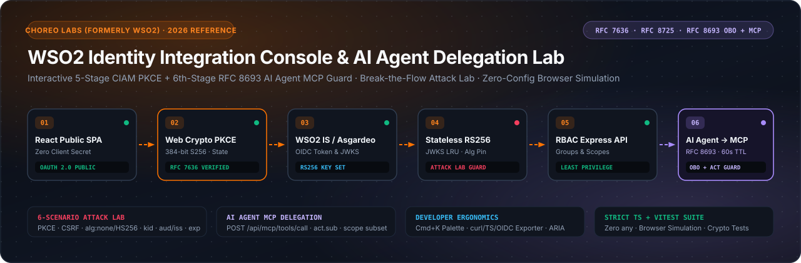
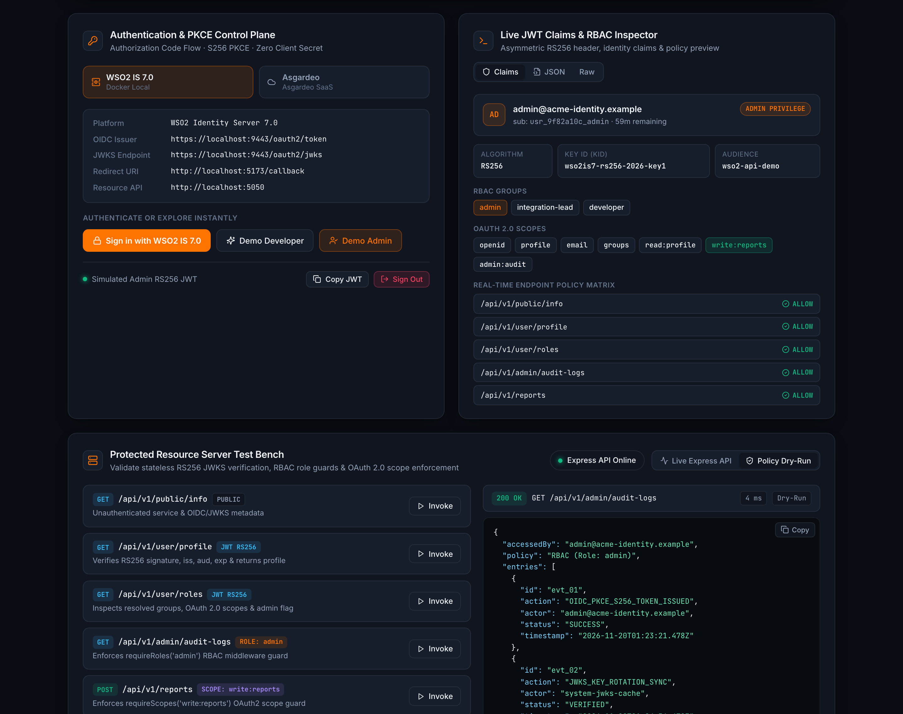
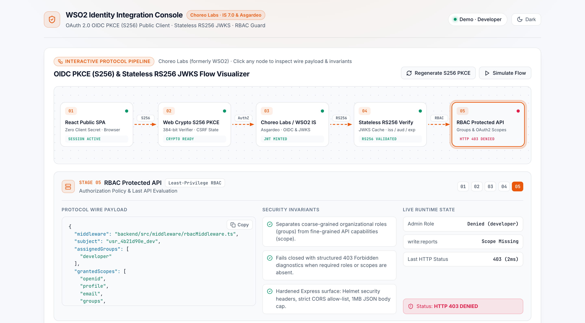
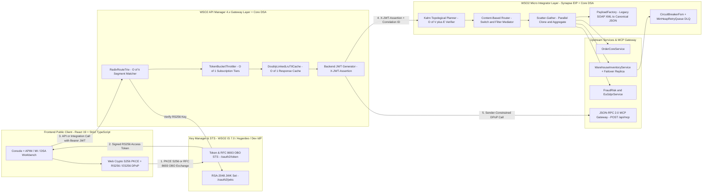
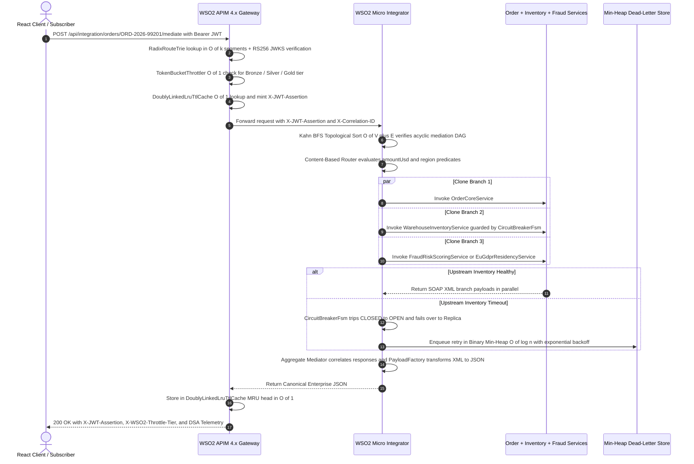

<div align="center">

# Choreo Labs (formerly WSO2) — Identity (IS 7.0), API Manager (APIM 4.x), Micro Integrator (EIP) & Core DSA Reference Platform (v3.0)

**Cryptographically real, spec-compliant full-stack WSO2 Integration, API Management, CIAM & AI Agent Identity reference platform — WSO2 API Manager 4.x, WSO2 Micro Integrator (Synapse / Ballerina EIP), WSO2 Identity Server 7.0 & Asgardeo.**
*Featuring an interactive WSO2 APIM Gateway + Micro Integrator EIP Workbench (`X-JWT-Assertion`, Content-Based Router, Scatter-Gather `<clone>`/`<aggregate>`, `<payloadFactory>`, Circuit Breaker & Min-Heap DLQ), a 5-Structure Core DSA Engine (`RadixRouteTrie`, `DoublyLinkedLruTtlCache`, `TokenBucketThrottler`, `CircuitBreakerFsm` + `MinHeapRetryQueue`, `planMediationDag`), a 6-Stage OIDC PKCE & RFC 8693 / DPoP / CIBA AI Agent MCP Pipeline, and a 10-Scenario Attack Lab.*

### [▶ Launch Interactive Live Demo (GitHub Pages)](https://theekshana-sudeepa.github.io/wso2-identity-integration-demo/)

[](https://theekshana-sudeepa.github.io/wso2-identity-integration-demo/)
[](https://github.com/theekshana-sudeepa/wso2-identity-integration-demo/actions)
[](./LICENSE)
[](./integration-artifacts/wso2-mi-synapse/EnterpriseOrderIntegrationAPI.xml)
[](./backend/src/dsa/integrationDsaEngine.ts)
[](./backend/src/routes/mcpRoutes.ts)
[](https://www.typescriptlang.org/)
[](./backend/src/__tests__/integrationDsaAndEip.test.ts)

</div>



---

## Executive Capabilities Summary

| Capability | Protocol / Standard / WSO2 Product | What You Can Inspect & Test |
| :--- | :--- | :--- |
| **WSO2 API Manager (APIM 4.x) Gateway Mediation** | `WSO2 APIM 4.3` · `X-JWT-Assertion` · `Token Bucket Tiers` · `apictl api.yaml` | `POST /api/integration/orders/:orderId/mediate` performs `O(k)` Radix Trie route matching, enforces Subscription Throttling Tiers (`Bronze`, `Silver`, `Gold`, `AI-Agent-MCP`), caches responses in an `O(1)` Doubly-Linked List LRU Cache, and mints signed **`X-JWT-Assertion`** backend context JWTs (`http://wso2.org/claims/enduser`, `tier`, `role`). |
| **WSO2 Micro Integrator (MI) & Enterprise Integration Patterns (EIP)** | `Apache Synapse XML` · `Ballerina Swan Lake` · `CBR` · `Scatter-Gather` · `PayloadFactory` | Executes **Content-Based Routing (`<filter>`/`<switch>`)**, parallel **Scatter-Gather (`<clone>` + `<aggregate>`)** across Order, Inventory, and Fraud/GDPR services, **Message Transformation (`<payloadFactory>`)** from legacy SOAP/XML to Canonical JSON, and **Endpoint Circuit Breaker + Dead-Letter Message Store (`<store>`)** failover. |
| **5-Structure Core DSA Engine (Built From Scratch)** | `RadixRouteTrie` · `DoublyLinkedLruTtlCache` · `TokenBucketThrottler` · `MinHeapRetryQueue` · `planMediationDag` | Zero-dependency, complexity-annotated Data Structures & Algorithms powering the APIM Gateway and Micro Integrator with live Big-O telemetry (`GET /api/integration/dsa-telemetry`) and interactive UI inspection of pointer chains, binary heap order, and topological waves. |
| **5-Stage Human CIAM + Local Dev IdP / STS** | `WSO2 IS 7.0` · `Asgardeo` · `OAuth 2.0` · `OIDC Core 1.0` · `RFC 7636 S256` · `RFC 7517` | In-process RSA-2048 Dev IdP (`/dev-idp/*`) with active + rotated `kid` keys, real SHA-256 PKCE code exchange (`developer`, `admin`, `auditor` personas), stateless `RS256` JWKS cache, and **Stage 04 Stateless JWKS vs. RFC 7662 Token Introspection + RFC 7009 Revocation** trade-off toggle. |
| **Spec-Compliant MCP Gateway, RFC 8693 OBO, DPoP & CIBA** | `MCP 2025-06-18` · `JSON-RPC 2.0` · `RFC 8693` · `RFC 9449 DPoP` · `RFC 9728` · `RFC 8707` | `POST /api/mcp` (`tools/list` & `tools/call`), sender-constrained `ES256` DPoP proofs (`cnf.jkt` + `jti` replay cache), interactive **CIBA Push Approval Card** (`auth_req_id` → one-time `120s` step-up consent), and **10-Scenario Break-the-Flow Attack Lab**. |

---

## Core Data Structures & Algorithms (DSA) Powering WSO2 APIM & Micro Integrator

Every stage of the WSO2 API Manager Gateway and Micro Integrator EIP pipeline is backed by a first-principles data structure in [integrationDsaEngine.ts](./backend/src/dsa/integrationDsaEngine.ts) and verified in [integrationDsaAndEip.test.ts](./backend/src/__tests__/integrationDsaAndEip.test.ts):

| # | Data Structure / Algorithm | Time Complexity | Space Complexity | WSO2 APIM / Micro Integrator Subsystem |
| :--- | :--- | :--- | :--- | :--- |
| **1** | **Radix Prefix Segment Trie (`RadixRouteTrie`)** | Lookup / Insert: `O(k)` path segments | `O(N * k)` | **WSO2 APIM Gateway URI-Template Matcher** — matches `/api/integration/orders/:orderId/mediate` and extracts path parameters with `Static > :param > *` precedence without `O(N)` linear regex scans. |
| **2** | **Doubly-Linked List + HashMap LRU Cache (`DoublyLinkedLruTtlCache`)** | `get` / `put` / `evict`: Strict `O(1)` | `O(C)` capacity | **WSO2 APIM Response Cache & JWKS Cache** — pointer-based `prev`/`next` node splicing promotes accessed keys to MRU head and evicts LRU tail in `O(1)` with live MRU↔LRU pointer chain inspection. |
| **3** | **Token Bucket Continuous Refill (`TokenBucketThrottler`)** | `tryConsume`: `O(1)` arithmetic refill | `O(S)` active subscribers | **WSO2 APIM Traffic Manager Subscription Tiers** — enforces `Bronze` (`5 burst / 60 rpm`), `Silver` (`15 burst / 180 rpm`), `Gold` (`50 burst / 600 rpm`), and `AI-Agent-MCP` quotas via lazy `min(cap, tokens + dt * rate)` math. |
| **4** | **FSM Circuit Breaker + Binary Min-Heap (`CircuitBreakerFsm` + `MinHeapRetryQueue`)** | FSM: `O(1)` · Heap Push/Pop: `O(log n)` · Peek: `O(1)` | `O(n)` queued DLQ messages | **WSO2 Micro Integrator Endpoint Resiliency & Message Processor DLQ** — transitions `CLOSED -> OPEN -> HALF_OPEN -> CLOSED` on upstream failures and orders Dead-Letter retries by earliest exponential backoff `nextRetryMs = now + 1000 * 2^attempt`. |
| **5** | **DAG Kahn's BFS Topological Sort & Cycle Verifier (`planMediationDag`)** | Schedule & Cycle Check: `O(V + E)` | `O(V + E)` | **WSO2 Micro Integrator Mediation Sequence Planner** — computes level-order parallel execution waves (proving concurrent `<clone>` scatter-gather branches in Wave 5) and blocks cyclic mediator graphs (`400 mediation_dag_cycle_detected`). |

---

## Quick Start: Local Full-Stack, Docker Profiles & Static Demo

```bash
# 1. Install dependencies
npm install --prefix backend && npm install --prefix frontend

# 2. Run full verification (Strict TypeScript + ESLint + Prod Build + 45 Vitest DSA, EIP & Security Specs)
npm run check

# 3. Run Full-Stack with live Express WSO2 APIM + Micro Integrator + Dev IdP / STS
npm run dev:backend   # Terminal 1 -> http://localhost:5050 (APIM/MI + Dev IdP + Scalar Docs at /api/docs)
npm run dev:frontend  # Terminal 2 -> http://localhost:5173

# 4. Or launch via Docker Compose (Fast Dev IdP profile or Full WSO2 IS 7.0 + DCR Bootstrap profile)
docker compose -f docker/docker-compose.yml --profile dev up --build
# docker compose -f docker/docker-compose.yml --profile wso2 up -d
```

---

## Visual Showcase

### 1. Interactive OIDC PKCE (S256) & Stateless RS256 JWKS Flow Visualizer

Click or Arrow-key through the protocol pipeline (`React Public SPA` -> `Web Crypto S256 PKCE` -> `Choreo Labs / WSO2 IS 7.0 & Dev IdP` -> `Stateless RS256 JWKS Verify` -> `RBAC Protected API` -> `AI Agent OBO + DPoP -> MCP Gateway`) to inspect live Web Crypto PKCE artifacts, Break-the-Flow Attack Lab defense traces, and RFC invariants.


### 2. Identity Control Plane, Live JWT Claims & RBAC Matrix Inspector, and API Test Bench

Switch seamlessly between **WSO2 Identity Server 7.0** and **Asgardeo Cloud** presets, authenticate with **Developer**, **Admin**, or **Auditor** personas via real S256 PKCE exchanges, inspect Human or RFC 8693 + DPoP Delegated Agent (`act.sub`, `cnf.jkt`, 60s TTL countdown, stripped scopes) JWT claims, and invoke protected endpoints with live latency telemetry.



### 3. First-Class Light & Dark Theme Parity (Asgardeo Cloud + 403 RBAC Policy Rejection)

Engineered with Apple / Linear developer-tool polish and full Dark/Light token parity across SVG pipeline graphs, syntax-highlighted JSON payloads, `Cmd+K` Command Palette, Code Exporter Drawer (including **WSO2 MI Synapse XML** and **Ballerina `.bal`**), and real-time RBAC / MCP policy rejection diagnostics (`HTTP 401` / `HTTP 403` with RFC 6750 `WWW-Authenticate` challenges).



---

## End-to-End WSO2 Architecture (Identity Server 7.0 + API Manager 4.x + Micro Integrator EIP + Core DSA)



---

## WSO2 API Manager + Micro Integrator Scatter-Gather & Circuit Breaker Sequence



---

## API & Protocol Endpoints Specification

| Method | Endpoint | Access Policy | Description |
| :--- | :--- | :--- | :--- |
| `POST` | `/api/integration/orders/:orderId/mediate` | `RS256` JWT + `APIM Tier Quota` | **WSO2 APIM + Micro Integrator EIP Pipeline**: Radix Trie route match, Token Bucket tier check, `X-JWT-Assertion` minting, Doubly-Linked LRU cache, Content-Based Router, 3-way Scatter-Gather, `PayloadFactory` XML→JSON transform, Circuit Breaker & Min-Heap DLQ |
| `GET` | `/api/integration/dsa-telemetry` | Public Demo Telemetry | Live state and Big-O complexity proofs for all 5 Core Data Structures (`RadixRouteTrie`, `DoublyLinkedLruTtlCache`, `TokenBucketThrottler`, `CircuitBreakerFsm`, `MinHeapRetryQueue`, `planMediationDag`) |
| `POST` | `/api/integration/reset` | Public Demo Control | Resets Token Buckets, Doubly-Linked LRU cache, Circuit Breaker FSM, and Min-Heap Retry Queue |
| `GET` | `/health` | Public | Resource server & Dev IdP status, active/rotated `kid`, `audience`, and `mcpAudience` |
| `GET` | `/.well-known/oauth-protected-resource` | Public (`RFC 9728`) | Protected Resource Metadata (`resource`, `authorization_servers`, `scopes_supported`, `dpop_signing_alg_values_supported`) |
| `GET` | `/api/openapi.json` & `/api/docs` | Public (`OpenAPI 3.1`) | Machine-readable OpenAPI 3.1 specification and interactive Scalar API Reference UI |
| `GET` | `/api/v1/public/info` | Public | Service metadata and Choreo Labs WSO2 IS 7.0 / Asgardeo protocol details |
| `GET` | `/api/v1/user/profile` | `RS256` JWT (`jwks` or `introspect`) | Verified identity claims; supports `X-Verification-Mode: jwks \| introspect` |
| `GET` | `/api/v1/user/roles` | `RS256` JWT | Resolved RBAC groups, OAuth 2.0 scopes, and computed admin flag |
| `GET` | `/api/v1/admin/audit-logs` | RBAC Role (`admin`) | Security audit telemetry; rejects non-admin principals with `403` + `WWW-Authenticate` |
| `POST` | `/api/v1/reports` | OAuth2 Scope (`write:reports`) | Creates a compliance report when `write:reports` scope is granted |
| `POST` | `/api/mcp` (and `/api/mcp/tools/call`) | `RS256` (`MCP_AUDIENCE`) + `RFC 8693 act` + `RFC 9449 DPoP` | JSON-RPC 2.0 MCP Gateway (`tools/list` & `tools/call`) with `60s` TTL, nested `act` guard, schema validation, and CIBA step-up |
| `GET` | `/api/mcp/audit` | Public Demo Telemetry | Returns the in-memory ring buffer (`50` entries) of delegated AI agent tool decisions |
| `GET` | `/dev-idp/.well-known/openid-configuration` | Dev IdP (`DEV_IDP_ENABLED`) | Local Dev IdP OIDC Discovery metadata and seeded personas (`developer`, `admin`, `auditor`) |
| `GET` | `/dev-idp/oauth2/jwks` | Dev IdP (`RFC 7517`) | Publishes active and rotated RSA-2048 public keys in JWK Set format |
| `POST` | `/dev-idp/oauth2/authorize` & `/dev-idp/oauth2/token` | Dev IdP / STS | Issues single-use S256 PKCE authorization codes, verifies `code_verifier` SHA-256 digests, and performs RFC 8693 OBO token exchanges |
| `POST` | `/dev-idp/oauth2/ciba/decide` | Dev IdP CIBA Step-Up | Approves or denies pending `auth_req_id` step-up consent requests and mints one-time approval claims |
| `POST` | `/dev-idp/oauth2/revoke` & `/dev-idp/oauth2/introspect` | Dev IdP (`RFC 7009` / `7662`) | Revokes active tokens and provides stateful RFC 7662 introspection responses |

---

## Deployable WSO2 Artifacts & Architecture Decision Records (ADRs)

- **[WSO2 Micro Integrator Synapse XML Artifact](./integration-artifacts/wso2-mi-synapse/EnterpriseOrderIntegrationAPI.xml)** — Declarative `<api>`, `<filter>`, `<switch>`, `<clone>`, `<aggregate>`, `<payloadFactory>`, and `<store>` Dead-Letter Channel sequence.
- **[WSO2 API Manager 4.x Declarative Definition (`api.yaml`)](./integration-artifacts/wso2-apim/api.yaml)** — `apictl`-compatible API specification with `Bronze`/`Silver`/`Gold` policies, `backendJwtConfiguration` (`X-JWT-Assertion`), response caching, and failover endpoints.
- **[WSO2 Ballerina Cloud-Native Service (`order_integration_service.bal`)](./integration-artifacts/ballerina/order_integration_service.bal)** — Ballerina Swan Lake service with declarative JWKS listener auth, HTTP `circuitBreaker`, and concurrent `fork`/`wait` workers.
- **[STRIDE Threat Model & Control Matrix](./docs/threat-model.md)** — Maps every Attack Lab fault and threat vector to normative RFC sections, middleware guards, and Vitest test names.
- **[ADR 0001: Stateless RS256 JWKS Verification vs. Stateful RFC 7662 Token Introspection](./docs/adr/0001-stateless-jwks-vs-token-introspection.md)**
- **[ADR 0002: RFC 8693 On-Behalf-Of (OBO) Token Exchange Over Token Passthrough for MCP Agents](./docs/adr/0002-rfc8693-obo-over-token-passthrough.md)**
- **[ADR 0003: RFC 9449 DPoP Sender-Constrained Tokens for Delegated AI Agents](./docs/adr/0003-rfc9449-dpop-for-ai-agents.md)**
- **[ADR 0004: Shared Pure-TypeScript Identity Policy Package & Contract Testing](./docs/adr/0004-shared-identity-policy-package.md)**
- **[ADR 0005: WSO2 API Manager (APIM 4.x) Gateway Mediation, Micro Integrator EIP Pipeline & Core Data Structures](./docs/adr/0005-wso2-apim-micro-integrator-and-core-dsa.md)**

---

## Repository Structure

```text
wso2-identity-integration-demo/
├── integration-artifacts/               # Deployable WSO2 Product Artifacts
│   ├── wso2-mi-synapse/
│   │   └── EnterpriseOrderIntegrationAPI.xml # WSO2 Micro Integrator Synapse XML (CBR, Clone/Aggregate, PayloadFactory, DLQ)
│   ├── wso2-apim/
│   │   └── api.yaml                          # WSO2 API Manager 4.x apictl declarative definition & X-JWT-Assertion config
│   └── ballerina/
│       └── order_integration_service.bal     # WSO2 Ballerina Swan Lake concurrent Scatter-Gather & Circuit Breaker service
├── packages/
│   └── identity-policy/                 # Shared pure-TS policy constants, RBAC matrix & DSA catalog
│       ├── src/index.ts
│       ├── package.json
│       └── tsconfig.json
├── backend/
│   ├── src/
│   │   ├── dsa/
│   │   │   └── integrationDsaEngine.ts       # 5 Core Data Structures (RadixTrie, DoublyLinkedLRU, TokenBucket, FSM+MinHeap, Kahn DAG) + APIM/MI runtime
│   │   ├── __tests__/
│   │   │   ├── integrationDsaAndEip.test.ts  # Unit & integration specs for all 5 Data Structures and /api/integration/*
│   │   │   ├── advancedAgentSecurity.test.ts # CIBA step-up, RFC 9449 DPoP & RFC 7662 introspection specs
│   │   │   ├── agentPolicy.drift.test.ts     # Frontend/backend constant drift guard
│   │   │   ├── delegationPolicy.test.ts      # RFC 8693 §4.1 nested act & §4.4 may_act unit tests
│   │   │   ├── devIdp.test.ts                # Local Dev IdP PKCE S256, OBO STS & live Attack Lab specs
│   │   │   ├── mcpSpec.test.ts               # JSON-RPC 2.0, RFC 9728, RFC 8707 & audit ring buffer specs
│   │   │   ├── policyContract.test.ts        # Full-matrix contract test (Shared Policy vs Express)
│   │   │   └── security.test.ts              # RS256 pinning, typed errors, RFC 6750 headers & audience isolation
│   │   ├── config/
│   │   ├── devIdp/
│   │   ├── mcp/
│   │   ├── middleware/
│   │   ├── routes/
│   │   │   ├── apiRoutes.ts                  # Public, authenticated, RBAC & scope-protected REST routes
│   │   │   ├── integrationRoutes.ts          # WSO2 APIM Gateway + Micro Integrator EIP & Core DSA Telemetry endpoints
│   │   │   ├── mcpRoutes.ts                  # JSON-RPC 2.0 MCP Gateway & audit log route
│   │   │   └── openApiSpec.ts                # OpenAPI 3.1 spec generator & Scalar API Reference UI
│   │   ├── types/
│   │   └── server.ts                         # Hardened Express bootstrap
│   └── Dockerfile
├── frontend/
│   ├── src/
│   │   ├── __tests__/
│   │   │   ├── integrationDsaEngine.test.ts  # Frontend APIM/MI simulation & Synapse XML / Ballerina exporter tests
│   │   │   ├── flowAndState.test.ts          # ConsoleReducer, StageDescriptors, DPoP, CIBA & Exporter tests
│   │   │   └── security.test.ts              # RFC 7636 S256 vector & Web Crypto RS256 verification suite
│   │   ├── components/
│   │   │   ├── flow/
│   │   │   ├── IntegrationWorkbench.tsx      # Interactive WSO2 APIM + Micro Integrator EIP + 5-Structure Core DSA Workbench
│   │   │   ├── ApiTestBench.tsx
│   │   │   ├── AttackLabPanel.tsx            # 10-scenario interactive Break-the-Flow Attack Lab
│   │   │   ├── AuthSessionCard.tsx           # WSO2 IS / Asgardeo preset switcher & 3 seeded personas
│   │   │   ├── CodeExporterDrawer.tsx        # Exports curl, TypeScript, OIDC JSON, WSO2 MI Synapse XML & Ballerina (.bal)
│   │   │   ├── CommandPalette.tsx
│   │   │   ├── JsonHighlighter.tsx
│   │   │   ├── JwtClaimsInspector.tsx
│   │   │   ├── OidcFlowVisualizer.tsx
│   │   │   └── TokenTtlBadge.tsx
│   │   ├── lib/
│   │   │   ├── integrationDsaEngine.ts       # Browser-side Core DSA & WSO2 APIM/MI EIP engine for GitHub Pages parity
│   │   │   ├── agentPolicy.ts
│   │   │   ├── apiClient.ts
│   │   │   ├── browserCrypto.ts
│   │   │   ├── pkce.ts
│   │   │   └── securityLab.ts
│   │   ├── state/
│   │   └── App.tsx
│   └── Dockerfile
├── e2e/
│   └── console.spec.ts                       # Playwright E2E verification suite
├── docker/
│   ├── docker-compose.yml                    # --profile dev (fast full stack) & --profile wso2 (IS 7.0 + DCR)
│   └── wso2-bootstrap.sh                     # Automated WSO2 IS 7.0 DCR & SCIM2 bootstrap script
├── docs/
│   ├── adr/                                  # 5 Architecture Decision Records (including ADR 0005 for APIM/MI & Core DSA)
│   ├── screenshots/                          # UI showcase captures
│   ├── threat-model.md                       # STRIDE threat-to-control matrix
│   └── wso2-setup-guide.md
├── CHANGELOG.md
├── SECURITY.md
├── playwright.config.ts
└── README.md
```

---

## License

This project is licensed under the **MIT License** — see the [LICENSE](./LICENSE) file for full details.

---

<div align="center">

**Engineered by Theekshana Sudeepa**

[](https://www.linkedin.com/in/theekshana-sudeepa/)
[](https://github.com/theekshana-sudeepa)
[](https://lexoratech.com)

</div>
